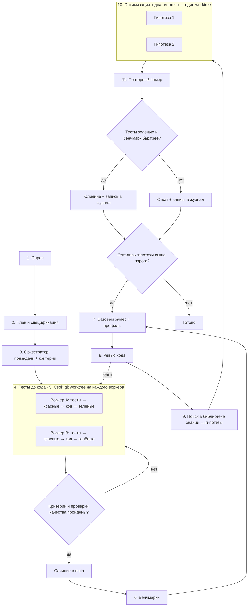

# Пайплайн разработки и оптимизации кода на C#

Порядок работы над задачей на C#/.NET: от постановки до кода с зелёными тестами, затем цикл оптимизации. В цикле код ускоряется только по замерам, а каждая правка опирается на источник из библиотеки знаний скилла. Пайплайн не зависит от предметной области и подходит для библиотек, веб-сервисов, десктопа, CLI, игр и данных. Команды проверены на .NET SDK 10.0.401 (октябрь 2026).

- [Схема](#схема)
- [Роли и модели](#роли-и-модели)
- [Этапы](#этапы)
- [Обязательные проверки качества](#обязательные-проверки-качества)
- [Этап 6. Бенчмарки](#этап-6-бенчмарки)
- [Этап 7. Базовый замер и профиль](#этап-7-базовый-замер-и-профиль)
- [Этап 8. Ревью кода](#этап-8-ревью-кода)
- [Этап 9. Поиск в библиотеке знаний](#этап-9-поиск-в-библиотеке-знаний)
- [Этапы 10–11. Оптимизация и повторный замер](#этапы-1011-оптимизация-и-повторный-замер)
- [Короткий режим](#короткий-режим)
- [Почему так](#почему-так)

## Схема



## Роли и модели

Пайплайн рассчитан на агента с субагентами. Если субагентов нет, один агент проходит те же этапы последовательно, а вместо worktree использует отдельные ветки.

| Роль | Рекомендуемая модель | Этапы |
| --- | --- | --- |
| Оркестратор: опрос, план, распределение работы, ревью, поиск решений, приёмка | Старшая модель, например Claude Opus 5.5 | 1–3, приёмка, 8, 9, решение на 11 |
| Воркер: основной код, тесты, бенчмарки, оптимизации | Средняя модель, например Claude Sonnet 5.5 | 4, 6, 10 |
| Рутина: простые правки, прогоны команд, сбор цифр | Быстрая модель, например Claude Haiku 4.5 | 4 (рутина), 7, 11 (замер) |

Старшая модель только управляет и проверяет. Основной объём кода пишут более дешёвые модели.

## Этапы

| Этап | Что делает | Команда агенту |
| --- | --- | --- |
| 1. Опрос | Задаёт уточняющие вопросы: цель, ограничения, целевые платформы и TFM (`net10.0`, `netstandard2.0` для библиотек), нужен ли Native AOT или trimming, требования к скорости, памяти и времени старта | «Прежде чем начать, задай мне вопросы по задаче» |
| 2. План и спецификация | Фиксирует план и спеку файлом. Отдельно перечисляет горячие пути и бюджет производительности: что, насколько быстрым и с каким числом аллокаций должно быть | «Составь план и спецификацию, отдельно перечисли критичные по скорости и аллокациям места» |
| 3. Оркестратор | Делит план на независимые подзадачи с критериями приёмки. Структуру решения и слои сверяет с [architecture.md](architecture.md) | «Разбей план на подзадачи с критериями готовности» |
| 4. Тесты до кода | Пишет тесты по спеке, видит красные, пишет код и чинит до зелёных | «Сначала тесты по спеке, запусти — должны быть красными. Потом код, пока все не зелёные» |
| 5. Изоляция | Отдельный git worktree на каждого воркера | «Работай в отдельном worktree, main не трогай» |
| Приёмка | Сверяет результат с критериями и [проверками качества](#обязательные-проверки-качества): слияние или возврат | «Проверь ветку по критериям и покажи вывод сборки и тестов» |
| 6. Бенчмарки | Пишет бенчмарки BenchmarkDotNet на горячие пути из спеки. После этапа они заморожены | «Напиши бенчмарки BenchmarkDotNet с `[MemoryDiagnoser]` на горячие пути из спеки» |
| 7. Базовый замер + профиль | Снимает базовую линию и профиль самого медленного бенчмарка | «Сохрани базовую линию в JSON и сними профиль самого медленного бенчмарка» |
| 8. Ревью кода | Стандартное ревью: баги, безопасность, идиоматичность, архитектура | «Сделай ревью: баги отдельно, замечания по скорости и дизайну отдельно» |
| 9. Поиск в библиотеке знаний | Сопоставляет профиль и замечания ревью с разделами справочников и пишет гипотезы | «По профилю и ревью найди решения в библиотеке знаний и оформи карточки гипотез» |
| 10. Оптимизация | Каждая гипотеза реализуется отдельно, тесты и бенчмарки не меняются | «Реализуй гипотезу N в отдельном worktree, тесты и бенчмарки не трогай» |
| 11. Повторный замер | Прогоняет бенчмарки и сравнивает с базовой линией, оркестратор решает: слить или откатить | «Сравни с базовой линией скриптом compare-bdn и покажи изменения по каждому бенчмарку» |

## Обязательные проверки качества

Перед любым слиянием в `main`, и на приёмке, и на этапе 11, ветка проходит минимальный набор проверок. Подробности по каждому инструменту и шаблоны `Directory.Build.props`, `.editorconfig` и `global.json` — в [toolchain.md](toolchain.md).

```bash
dotnet restore --locked-mode                                  # или dotnet restore, если lock-файлов нет
dotnet format --verify-no-changes --no-restore
dotnet build -c Release --no-restore -p:TreatWarningsAsErrors=true
dotnet test -c Release --no-build --minimum-expected-tests 1  # в режиме MTP; на VSTest без последнего флага
dotnet package list --vulnerable --include-transitive --format json > vuln.json
grep -q '"severity"' vuln.json && echo "vulnerable packages found" && exit 1
```

Оговорки, проверенные на SDK 10.0.401:

- `dotnet package list --vulnerable` всегда возвращает код 0, поэтому проверку делает `grep` по JSON. Текстовый вывод локализован, и поиск по английской фразе на машине с другим языком интерфейса не сработает.
- `-p:TreatWarningsAsErrors=true` превращает предупреждения компилятора и анализаторов в ошибки, но учитывает `WarningsNotAsErrors`. Если там перечислены NU1901–NU1904, уязвимые пакеты ловит только отдельный шаг с `package list`. Флаг `-warnaserror` действует иначе: он игнорирует `WarningsNotAsErrors`, и сборка падает уже на уязвимом пакете (проверено на обоих вариантах).
- Режим Microsoft.Testing.Platform включается в `global.json` (`"test": { "runner": "Microsoft.Testing.Platform" }`), и каждый тестовый проект должен его поддерживать. Иначе `dotnet test` завершится с кодом 1. При нехватке тестов `--minimum-expected-tests` даёт код 9.

По ситуации добавляются:

- `dotnet ef migrations has-pending-model-changes`, если в проекте EF Core;
- Package Validation (`EnablePackageValidation` и `PackageValidationBaselineVersion`), если это публикуемая библиотека;
- `dotnet publish -c Release -p:PublishAot=true` и проверка предупреждений trimming и AOT (IL2xxx, IL3xxx), если приложение собирается в Native AOT;
- Stryker.NET по диффу (`dotnet stryker --since:main`), если важна сила тестов.

Не ставьте `TreatWarningsAsErrors` безусловно в пакет, который собирают пользователи: новая версия SDK с новыми анализаторами сломает им сборку. Строгость включайте в проверках свойством из командной строки, как выше, или условием на `CI=true` в `Directory.Build.props` ([toolchain.md](toolchain.md), раздел «Компилятор и анализаторы»).

## Этап 6. Бенчмарки

- **Мерить то, что важно пользователю.** Горячие пути берутся из спеки, а не из догадок воркера. Это может быть разбор входа, обработка запроса, сериализация, запрос к EF Core, шаг симуляции.
- **Детерминизм.** Входные данные готовятся в `[GlobalSetup]`, у `Random` фиксированный seed (`new Random(42)`), данные реалистичные по размеру. Результат возвращается из метода бенчмарка, чтобы JIT не выкинул вычисление.
- **Инструмент — BenchmarkDotNet.** Отдельный консольный проект `bench/`, в `Program.cs` строка `BenchmarkSwitcher.FromAssembly(typeof(Program).Assembly).Run(args);`, на классах `[MemoryDiagnoser]`. Аллокации на операцию часто важнее времени.
- **Сравнение рантаймов или вариантов в одном прогоне** — `[Benchmark(Baseline = true)]` и колонка `Ratio`. Сравнение «до/после правки» — через сохранённый JSON (этап 7).
- **Целиком приложение** мерьте отдельно: время старта и память процесса — `hyperfine` и `dotnet-counters`, HTTP-нагрузку — `bombardier`, k6 или crank.
- **Бенчмарки замораживаются.** Как и тесты, они контракт. Если на этапе 10 бенчмарк изменится, сравнение с базовой линией потеряет смысл.

Обзор: [performance.md](performance.md) (раздел «Бенчмарки: BenchmarkDotNet») и [toolchain.md](toolchain.md) (раздел 6).

## Этап 7. Базовый замер и профиль

```bash
dotnet run -c Release --project bench -- --filter "*" --exporters fulljson --artifacts bdn/before
```

- Результаты ложатся в `bdn/before/results/*-report-full.json`. Скрипт сравнения читает именно их.
- Если SDK стоит не в стандартном месте, BenchmarkDotNet 0.15.8 падает с `NullReferenceException` в `DotNetSdkValidator`. Добавьте `--cli <путь к dotnet>`.
- Базовая и повторная линии снимаются на одной машине, в Release, на той же версии рантайма, когда на машине не идёт другой тяжёлой работы. Шум между прогонами — главный источник ложных «ускорений».
- Профиль самого медленного сценария снимается `dotnet-trace collect` (результат открывается в PerfView, Visual Studio или speedscope) или dotTrace. Аллокации — `[MemoryDiagnoser]`, `dotnet-gcdump` или dotMemory. Подробности — [performance.md](performance.md), раздел «Профилирование и диагностика».
- Итог этапа — таблица: бенчмарк, время, аллокации, топ горячих методов из профиля.
- Если ревью на этапе 8 нашло баги и код после исправления поменялся, базовую линию нужно снять заново.

## Этап 8. Ревью кода

Ревью идёт до оптимизаций, потому что ускорять имеет смысл уже правильный код.

- Чеклисты:
  - идиоматичный код — [idioms-patterns.md](idioms-patterns.md), раздел «Чеклист code review»;
  - конкурентный, async и `unsafe`-код — [concurrency-async-unsafe.md](concurrency-async-unsafe.md), раздел «Чеклист review»;
  - архитектура — [architecture.md](architecture.md), разделы «Направление зависимостей и слои» и «Ошибки по слоям».
- Находки делятся на две группы:
  - **баги** — неверное поведение, исключение на корректном входе, гонки, deadlock из-за sync-over-async, утечки `IDisposable`, уязвимости. Возвращаются на этап 4 с тестом, который воспроизводит баг;
  - **можно сделать лучше** — скорость, аллокации, дизайн, идиоматичность. Идут на вход этапа 9.

## Этап 9. Поиск в библиотеке знаний

Оркестратор идёт от симптома к справочнику. Главная точка входа — таблица «Симптом → техника → источник» в [performance.md](performance.md).

| Что видно в профиле или ревью | Куда смотреть |
| --- | --- |
| Много аллокаций, `string` в горячем цикле, boxing, замыкания, LINQ в горячем пути | [performance.md](performance.md) → «Аллокации: Span, пулы, строки» |
| Частые сборки мусора, рост памяти, большие объекты в LOH | [performance.md](performance.md) → «GC и память» |
| `Dictionary`/`List` в горячем пути, поиск по множеству значений | [performance.md](performance.md) → «Коллекции и поиск» |
| Числовые циклы, обработка массивов | [performance.md](performance.md) → «SIMD и векторизация» |
| Медленный старт, большой размер, холодный JIT | [performance.md](performance.md) → «JIT, PGO, ReadyToRun и Native AOT», «Конфигурация сборки и рантайма» |
| JSON, regex, логирование, файлы и сокеты | [performance.md](performance.md) → «I/O, сериализация, regex, логирование» |
| Медленные запросы, N+1, тяжёлые эндпоинты | [performance.md](performance.md) → «EF Core и ASP.NET Core», [domains-server.md](domains-server.md) |
| Блокировки, голодание пула потоков, `async`, каналы, `unsafe`, P/Invoke | [concurrency-async-unsafe.md](concurrency-async-unsafe.md) |
| Неудобные абстракции, лишние интерфейсы и `virtual`, примитивные типы вместо доменных | [idioms-patterns.md](idioms-patterns.md) → «Мини-каталог паттернов», «Антипаттерны» |
| Запутанные зависимости проектов, долгие сборки | [architecture.md](architecture.md) → «Граф проектов и время сборки» |
| Проблема типична для домена (веб, данные, десктоп, мобильные, игры, ИИ…) | [domains-server.md](domains-server.md), [domains-client.md](domains-client.md) |
| Нужен инструмент для диагностики | [toolchain.md](toolchain.md) |
| Нужно глубже разобраться в теме | [books.md](books.md) |

Результат этапа — список карточек гипотез, отсортированный по ожидаемому эффекту:

```
Гипотеза N: <что меняем>
Где: <файл и метод>
Почему: <горячее место из профиля или замечание ревью>
Источник: <ссылка из библиотеки знаний>
Ожидаемый эффект: <какой бенчмарк и насколько должен ускориться, сколько аллокаций уйдёт>
Риск: <что может сломаться, нужен ли unsafe, совместимо ли с AOT и trimming>
```

Если в библиотеке нет решения под найденную проблему, это пишется в карточке прямо, без выдуманного решения. Такой пробел — повод дополнить библиотеку.

## Этапы 10–11. Оптимизация и повторный замер

Каждая гипотеза реализуется в своём worktree, чтобы эффект был виден отдельно. Затем:

```bash
dotnet run -c Release --project bench -- --filter "*" --exporters fulljson --artifacts bdn/after
dotnet run <путь к скиллу>/scripts/compare-bdn.cs -- bdn/before bdn/after 5
```

[compare-bdn.cs](../scripts/compare-bdn.cs) — однофайловое приложение .NET 10, без зависимостей. Для каждого бенчмарка оно печатает медианы и изменение. Вердикт `faster` или `slower` ставится, только если медиана сдвинулась больше порога и 99,9% доверительные интервалы прогонов не пересекаются, иначе `same`. Код выхода 1 означает, что хотя бы один бенчмарк замедлился.

Гипотеза сливается в `main`, только если выполнены все условия:

1. Все [проверки качества](#обязательные-проверки-качества) пройдены, тесты зелёные.
2. У целевого бенчмарка вердикт `faster`, а выигрыш не меньше порога из спеки. Порог по умолчанию — 5%.
3. Остальные бенчмарки не получили `slower`, аллокации на операцию не выросли.
4. Код не стал заметно хуже: оркестратор коротко проверяет правку. У каждого нового `unsafe`-блока есть комментарий, почему он корректен, и тест. Native AOT и trimming не получили новых предупреждений.

Иначе worktree удаляется. В обоих случаях результат записывается в журнал оптимизаций, например `docs/perf-log.md`:

| Гипотеза | Источник | До | После | Решение |
| --- | --- | --- | --- | --- |
| `Dictionary<string,…>` → `FrozenDictionary` в `RouteTable.Match` | ссылка из библиотеки | 182 нс, 0 B | 141 нс, 0 B | слита |

Журнал не даёт повторно проверять отклонённые идеи. Если гипотезы сливались, перед следующим кругом снимается новая базовая линия. Цикл 7–11 повторяется, пока остаются гипотезы с ожидаемым эффектом выше порога.

## Короткий режим

Для небольшой задачи (один метод, один баг) весь пайплайн избыточен. Достаточно:

1. Тест, который воспроизводит задачу.
2. Код до зелёного теста.
3. [Проверки качества](#обязательные-проверки-качества).
4. Ревью по чеклисту из [idioms-patterns.md](idioms-patterns.md).

Цикл оптимизации запускается, только если в задаче есть требование к скорости или памяти или профиль показал проблему.

## Почему так

- **Тесты — это контракт.** Если тесты написаны до кода, агент не подгонит их под уже сделанное. Фраза «готово, всё работает» без зелёного прогона ничего не значит.
- **Бенчмарки — тоже контракт.** Их пишут до оптимизаций и не трогают, поэтому «стало быстрее» подтверждается цифрами против базовой линии, а не ощущением.
- **Сначала корректность, потом скорость.** Ревью стоит до оптимизаций, и ускорять приходится уже правильный код.
- **Решения берутся из источников.** Каждая гипотеза ссылается на статью или книгу из библиотеки. Это отсекает выдуманные «оптимизации» и сразу даёт материал для разбора.
- **Одна гипотеза — один worktree.** Эффект каждой правки виден отдельно, и неудачную легко откатить, не задев удачные.
- **Worktree защищает main.** Параллельные воркеры не мешают друг другу и не ломают основную ветку.
